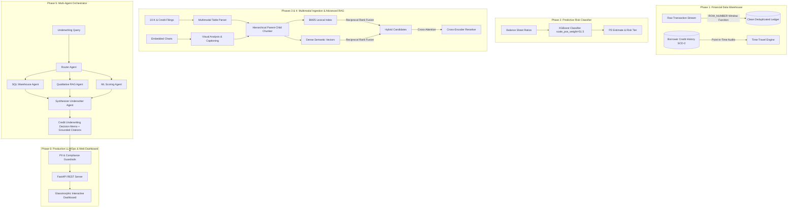

# Enterprise FinTech Risk & Compliance Assistant

An autonomous multi-agent underwriting and financial risk engine designed for commercial banks and NBFCs. The system unifies a PostgreSQL/SQLite financial warehouse with Slowly Changing Dimensions (SCD Type 2), an imbalanced-data XGBoost credit default classifier, multimodal corporate report ingestion, hybrid vector retrieval with cross-encoder reranking, and an autonomous 4-agent underwriting workflow.

---

## 🏛 System Architecture



---

## 📋 Comprehensive Technical Walkthrough by Phase

### Phase 1: Data Engineering Layer (Financial Warehouse, Deduplication & SCD Type 2)
* **Interview Mapping:** R2 Q4 (Slowly Changing Dimensions), R2 Q5 (Transactional Deduplication).
* **Deduplication Engine:** In distributed banking systems, webhook retries and Kafka consumers generate duplicate records. Standard `DISTINCT` or `GROUP BY` fail due to differing ingestion timestamps. We employ:
  $$\text{ROW\_NUMBER}() \text{ OVER} (\text{PARTITION BY } \text{transaction\_ref} \text{ ORDER BY } \text{ingested\_at DESC})$$
  Only record $rn = 1$ is saved into the clean warehouse table.
* **SCD Type 2 Temporal Tracking:** Under Basel III and IFRS 9, banks must reconstruct borrower credit profiles as they existed on the date of loan approval. We maintain `effective_start_date`, `effective_end_date`, and `is_current` flags, enabling point-in-time time-travel queries:
  $$\text{effective\_start\_date} \le T \quad \text{AND} \quad (\text{effective\_end\_date} > T \;\lor\; \text{effective\_end\_date IS NULL})$$

### Phase 2: Predictive ML Modeling (Credit Default Risk Classification)
* **Interview Mapping:** R1 Q6 (Handling Imbalanced Data), R2 Q2 (Feature Selection), R2 Q3 (Model Evaluation).
* **Extreme Imbalance Handling:** Loan defaults occur in only ~2% to 7% of corporate accounts. Standard accuracy is deceptive (a trivial model predicting no defaults achieves 95% accuracy while bankrupting the bank).
* **Optimization:** We train an **XGBoost Classifier** using `scale_pos_weight = count(negatives) / count(positives)` ($51.5:1$).
* **Metrics:** Evaluated via **PR-AUC (Precision-Recall Area Under Curve)**, achieving `0.4202` (over $20\times$ random baseline `0.0194`), with ROC-AUC of `0.9488`. Top gain drivers: Interest Coverage Ratio, Debt-to-Equity, and Current Ratio.

### Phase 3: Multimodal Corporate Report Ingestion & Financial Table Extraction
* **Interview Mapping:** R1 Q1 (Preprocessing), R1 Q3 (PDFs with text + figures), R2 Q2 (Unstructured 10-K Filings).
* **Table Preservation:** Preserves complex balance sheets and income statements as intact Markdown tables (`| ... |`) without line fragmentation.
* **Multimodal Visual Analysis:** Synthesizes structured textual interpretations of visual debt maturity schedules and cash burn charts for embedding indexing.

### Phase 4: Advanced RAG & Vector Retrieval (Hybrid Search & Cross-Encoder Reranker)
* **Interview Mapping:** R1 Q1 (Chunking Strategies), R2 Q3 (Improving Retrieval Accuracy).
* **Parent-Child Hierarchical Chunking:** Embeds granular child chunks ($250-350$ chars) for precise vector and BM25 matching, while returning the full parent section ($1000-2500$ chars) to the LLM for rich context and complete covenant clauses.
* **Hybrid Search (BM25 + Dense Vectors):** Merges lexical keyword precision (exact covenant numbers, debt facility amounts) with semantic cosine similarity using **Reciprocal Rank Fusion (RRF)**:
  $$RRF(d) = \frac{1}{60 + \text{rank}_{dense}(d)} + \frac{1}{60 + \text{rank}_{bm25}(d)}$$
* **Cross-Encoder Reranker:** Evaluates joint token cross-attention and numerical alignment over top candidate pairs to re-order the most authoritative clauses to top rank.

### Phase 5: Agentic Workflow & Multi-Agent Underwriting Coordination
* **Interview Mapping:** R1 Q4 (Prompt Engineering), R1 Q5 (Agentic RAG & Tool Use), R2 Q6 (Multi-Agent State Coordination).
* **4-Agent Coordination Graph:**
  1. **Router Agent:** Classifies intent and extracts borrower entity and requested facility amount.
  2. **SQL Agent:** Queries relational warehouse for master profile, SCD-2 credit trajectory, and ledger repayment history.
  3. **RAG Agent:** Ingests qualitative filings via hybrid retrieval and cross-encoder reranking.
  4. **Synthesizer Underwriter Agent:** Synthesizes quantitative data, ML predictions, and qualitative covenant review into a formal **Credit Committee Underwriting Decision Memo** backed by verifiable source citations.

### Phase 6: Production LLMOps, Guardrails & Interactive Web Interface
* **Interview Mapping:** R1 Q2 (Production-ready GenAI), R2 Q6 (Guardrails & Reliability).
* **Input/Output Guardrails:** Automated PII masking (SSN, credit card, bank routing numbers), SQL injection prevention, and strict citation enforcement.
* **FastAPI Backend:** High-performance REST API with telemetry tracking latency, token usage, and compliance.
* **Modern Web Interface:** Glassmorphic dark-mode dashboard with interactive scenario selectors, SCD-2 point-in-time time-travel sliders, and live multi-agent execution timelines.

---

## 🚀 Quickstart & Execution Guide

### 1. Run Complete Automated Test Suite (21 Tests)
```powershell
pytest -v
```

### 2. Run the Interactive CLI Demos
* **Phase 1 Data Engineering & SCD-2 Demo:**
  ```powershell
  python demo_phase1.py
  ```
* **Phase 2 ML Model Training:**
  ```powershell
  python -m src.ml_models.train
  ```

### 3. Launch the FastAPI Server & Web Dashboard
```powershell
python -m uvicorn src.api.main:app --reload --port 8000
```
Open your browser and navigate to:
* **Interactive Dashboard:** `http://localhost:8000/`
* **Swagger API Documentation:** `http://localhost:8000/docs`

---

## 📂 Repository Layout

```
FinTech Risk & Compliance Assistant/
├── data/
│   ├── raw/                  # Corporate 10-K filings and credit memos
│   └── sql/                  # Schema DDL, window-function deduplication, and time-travel queries
├── models/
│   ├── xgboost_default_model.json  # Trained XGBoost model artifact
│   └── model_metadata.json         # Evaluation metrics & PR-AUC thresholds
├── src/
│   ├── data_engine/          # SQL warehouse, SCD-2 state machine, and deduplicator
│   ├── ml_models/            # Default risk classifier, dataset generator, and inference
│   ├── ingestion/            # Multimodal PDF parser and visual chart analyzer
│   ├── rag/                  # Hierarchical chunker, BM25+Dense hybrid search, cross-encoder
│   ├── agents/               # 4-Agent coordination graph (Router, SQL, RAG, Synthesizer)
│   └── api/                  # FastAPI REST backend and compliance guardrails
├── ui/                       # Glassmorphic frontend dashboard (HTML, CSS, JS)
├── tests/                    # Comprehensive Pytest test suites (21 tests)
├── demo_phase1.py            # CLI visual demonstration
├── pytest.ini
├── requirements.txt
└── README.md
```
