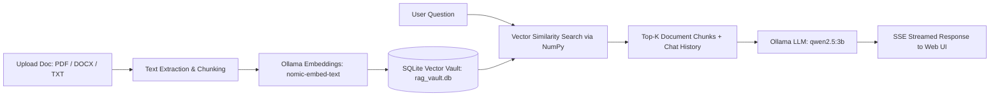

# RagVault (Local RAG Studio)

A privacy-first, fully local Retrieval-Augmented Generation (RAG) web application powered by **FastAPI**, **LangChain**, and **Ollama**. Ingest documents, index semantic vectors into SQLite, and chat with your files or general AI in real-time with zero external API keys or cloud dependencies.

---

## Features

- **100% Local & Private:** Powered by Ollama (`qwen2.5:3b` for chat and `nomic-embed-text` for embeddings). No API keys, no subscriptions, and zero data leaving your machine.
- **Multi-Format Document Ingestion:** Supports `.pdf`, `.docx`, and `.txt` files with page-level metadata tracking.
- **Unified SQLite Vector Store:** Embeddings are stored directly as binary BLOBs inside SQLite (`rag_vault.db`), with fast cosine similarity retrieval computed via NumPy.
- **Dual-Mode Conversational Engine:**
  - **Document RAG:** Answers questions grounded in attached documents with page-level citations and source snippets.
  - **General Knowledge:** Automatically falls back to open-ended conversation when no document is attached.
- **Streaming Web UI:** Modern, dark-themed responsive frontend (`index.html`) with token-by-token Server-Sent Events (SSE) streaming and session history management.
- **Modular Learning Pipeline:** Includes standalone step-by-step scripts (`step1` through `step4`) demonstrating each phase of building a RAG system from scratch.

---

## Project Structure

```text
RAG project/
├── app.py                   # FastAPI server, unified SQLite vector store & SSE streaming API
├── index.html               # Responsive web interface (Tailwind CSS, Markdown renderer)
├── requirements.txt         # Project dependencies
├── .gitignore               # Git rules (excludes venv, database, and uploaded documents)
├── README.md                # Project documentation
│
├── step1_loader.py          # Step 1: Document loading (PDF, DOCX, TXT)
├── step2_chunking.py        # Step 2: Recursive character text chunking
├── step3_vector_store.py    # Step 3: Standalone ChromaDB vector indexing prototype
├── step4_rag_chain.py       # Step 4: Standalone LangChain LCEL RAG chain prototype
│
└── data/                    # Storage directory for uploaded documents (git-ignored)
```

---

## Prerequisites

1. **Python 3.10+**
2. **[Ollama](https://ollama.com/)** installed and running on your system.

---

## Hardware Requirements & GPU / VRAM Limits

Because this application runs both embedding and generation models completely locally, resource consumption is governed by your GPU VRAM or system RAM:

| Component | Model Size | Dedicated VRAM (GPU Mode) | Fallback RAM (CPU Only) |
| :--- | :--- | :--- | :--- |
| **LLM (`qwen2.5:3b`)** | ~1.93 GB | ~2.5 GB – 3.5 GB | ~4.0 GB – 6.0 GB |
| **Embeddings (`nomic-embed-text`)** | ~274 MB | ~500 MB | ~1.0 GB |
| **FastAPI Backend + SQLite** | Lightweight | ~150 MB System RAM | ~150 MB System RAM |
| **Total System Recommendation** | **~2.2 GB** | **4 GB+ VRAM (NVIDIA / Apple Silicon)** | **8 GB+ System RAM** |

### GPU & Memory Guidelines:
- **Dedicated GPU (Recommended):**
  - Any GPU with **4 GB+ VRAM** (e.g., NVIDIA GTX 1650, RTX 3050/3060, Apple M1/M2/M3 unified memory) can fully load both models into VRAM, delivering real-time streaming speeds (**35–60+ tokens/sec**).
- **CPU & Integrated Graphics Fallback:**
  - If your PC has an integrated GPU (Intel Iris Xe / AMD Radeon) or less than 3 GB VRAM, Ollama automatically splits or offloads execution to your **System RAM and CPU**.
  - The app will run smoothly without crashing, with response speeds typically around **8–15 tokens/sec**.
- **Context Window Limits (`num_ctx`):**
  - Configured by default to `num_ctx = 3072` in `app.py` to keep memory footprint safe within a 4 GB VRAM budget.
  - If you increase `num_ctx` (e.g., to 8k or 16k) or increase `top_k` retrieved chunks significantly, VRAM usage will scale up. On 4 GB cards, keep `top_k <= 6` and `num_ctx <= 3072` to avoid Out-Of-Memory (OOM) spills to CPU.

---

## Model Setup (Why Models Are Not on GitHub)

> **Important:** Machine learning model weights (such as `qwen2.5:3b`, ~1.93 GB) are large binary files. GitHub enforces a strict 100 MB file limit, and storing multi-gigabyte models in Git repositories is an anti-pattern. Instead, model weights are pulled and managed locally via **Ollama**.

Before running the application, pull the required models via your terminal:

```bash
# 1. Pull the generation model (Qwen 2.5 3B)
ollama pull qwen2.5:3b

# 2. Pull the embedding model (Nomic Embed Text)
ollama pull nomic-embed-text
```

Verify that both models are ready:
```bash
ollama list
```

---

## Installation & Setup

### 1. Clone the Repository
```bash
git clone https://github.com/<your-username>/<your-repo-name>.git
cd "RAG project"
```

### 2. Create and Activate a Virtual Environment

**Windows:**
```powershell
python -m venv venv
.\venv\Scripts\activate
```

**macOS / Linux:**
```bash
python3 -m venv venv
source venv/bin/activate
```

### 3. Install Dependencies
```bash
pip install -r requirements.txt
```

---

## Running the Application

1. Ensure Ollama is running in the background (`ollama serve` or Ollama desktop app).
2. Start the FastAPI server:
   ```bash
   uvicorn app:app --reload --port 8000
   ```
3. Open your browser and navigate to:
   ```
   http://localhost:8000
   ```

---

## How It Works



1. **Ingestion & Indexing:** Uploaded files are parsed in [`step1_loader.py`](step1_loader.py) and split into chunks using LangChain's `RecursiveCharacterTextSplitter` in [`step2_chunking.py`](step2_chunking.py).
2. **Storage:** Chunks and their embeddings are stored in `rag_vault.db` (`document_chunks` table).
3. **Retrieval & Generation:** When a user queries an attached document, cosine similarity finds the top matching chunks. The prompt template combines the retrieved context, chat history, and current question, streaming the response directly to the frontend.

---

## Modular Pipeline (Step-by-Step Prototypes)

For learning or debugging individual components of the RAG architecture:

- **Run Document Loader:**
  ```bash
  python step1_loader.py
  ```
- **Run Text Chunker:**
  ```bash
  python step2_chunking.py
  ```
- **Test ChromaDB Vector Store:**
  ```bash
  python step3_vector_store.py
  ```
- **Test LCEL RAG Chain via CLI:**
  ```bash
  python step4_rag_chain.py
  ```

---

